<div align="center">

<a href="https://abhihackz.com"></a>

<br/>

[](https://abhihackz.com)
[](https://www.linkedin.com/in/abhi-hackz/)
[](https://hackerone.com/abhi_hackz)
[](https://bugcrowd.com/h/Abhi_Hackz)
[](https://abhihackz.com/cve/)
[](https://abhihackz.com/contact/)

</div>

<table>
<tr><td><b>Report&nbsp;ID</b></td><td><code>AH-PROFILE-2026</code></td><td><b>Classification</b></td><td><code>PUBLIC</code></td></tr>
<tr><td><b>Prepared&nbsp;by</b></td><td>Abhishek Nandkumar Bhaskar <sub>(Abhi HackZ)</sub></td><td><b>Status</b></td><td>🟢 Available for VAPT engagements</td></tr>
<tr><td><b>Role</b></td><td>Security Analyst · VAPT Engineer · CVE Researcher</td><td><b>Methodology</b></td><td>OWASP WSTG · MASVS/MASTG · PTES</td></tr>
</table>

---

## `01` &nbsp;Executive Summary

I break software the way real attackers do — then prove it, so the fix is never up for debate.
**5+ years** of offensive security across web, API, mobile, cloud, network and AI/LLM systems,
**1000+ applications and infrastructures** assessed, and **33 published CVEs** credited by the
Microsoft, Progress Software and HackerOne CVE Numbering Authorities.

<p align="center"></p>

## `02` &nbsp;Key Findings

> Selected public disclosures. Every one was reported privately, fixed by the vendor, then published.

| ID | Target | Finding | CVSS |
|---|---|---|:---:|
| [**CVE-2026-91140**](https://abhihackz.com/cve/CVE-2026-91140/) | Progress DataDirect · ARCGenAI-Generator | OS command injection via a crafted OpenAPI document → code execution on the developer's machine | 🔴 **9.6** |
| [**GHSA-grrq-9gq2-vm55**](https://github.com/OpenMage/magento-lts/security/advisories/GHSA-grrq-9gq2-vm55) | OpenMage (Magento LTS) | CSRF in OAuth authorization grants persistent admin/customer REST API tokens | 🔴 **9.0** |
| [**CVE-2026-119975**](https://abhihackz.com/cve/CVE-2026-119975/) | Microsoft · Visual Studio Code | Cross-site scripting escalating to remote code execution · acknowledged by MSRC | 🟠 **8.8** |
| [**CVE-2026-92931**](https://abhihackz.com/cve/CVE-2026-92931/) | Progress Sitefinity · Next.js SDK | Server-side request forgery to attacker-controlled hosts | 🟠 **8.8** |
| [**GHSA-7j66-6mw7-rgfx**](https://github.com/OpenMage/magento-lts/security/advisories/GHSA-7j66-6mw7-rgfx) | OpenMage (Magento LTS) | Predictable confirmation & password-reset tokens → account takeover | 🟠 **8.1** |
| [**CVE-2026-118975**](https://abhihackz.com/cve/CVE-2026-118975/) | Progress Telerik Reporting | XML external entity injection in SVG processing | 🟡 6.5 |

<details>
<summary><b>📂 Full disclosure log — 33 CVEs</b></summary>
<br/>

| CVE | Product | Weakness | CVSS | Severity |
|---|---|---|---|---|
| [CVE-2026-91140](https://abhihackz.com/cve/CVE-2026-91140/) | Autonomous REST Connector GenAI Agents | CWE-78 · OS Command Injection | **9.6** | 🔴 Critical |
| [CVE-2026-119975](https://abhihackz.com/cve/CVE-2026-119975/) | Microsoft Visual Studio Code | CWE-79 · XSS → Remote Code Execution | **8.8** | 🟠 High |
| [CVE-2026-92931](https://abhihackz.com/cve/CVE-2026-92931/) | @progress/sitefinity-nextjs-sdk | CWE-918 · SSRF | **8.8** | 🟠 High |
| [CVE-2026-124687](https://abhihackz.com/cve/CVE-2026-124687/) | Kendo UI for jQuery (DropDownButton/SplitButton) | CWE-80 · XSS | **7.1** | 🟠 High |
| [CVE-2026-124689](https://abhihackz.com/cve/CVE-2026-124689/) | Kendo UI for jQuery (ActionSheet) | CWE-79 · XSS | **7.1** | 🟠 High |
| [CVE-2026-124690](https://abhihackz.com/cve/CVE-2026-124690/) | Kendo UI for jQuery (SVG icon sanitizer) | CWE-79 · XSS | **7.1** | 🟠 High |
| [CVE-2026-124691](https://abhihackz.com/cve/CVE-2026-124691/) | Kendo UI for jQuery (Gantt parent dropdown) | CWE-79 · XSS | **7.1** | 🟠 High |
| [CVE-2026-124692](https://abhihackz.com/cve/CVE-2026-124692/) | Kendo UI for jQuery (Grid/TreeList reorder) | CWE-79 · XSS | **7.1** | 🟠 High |
| [CVE-2026-124693](https://abhihackz.com/cve/CVE-2026-124693/) | Kendo UI for jQuery (PivotGrid chips) | CWE-79 · XSS | **7.1** | 🟠 High |
| [CVE-2026-124694](https://abhihackz.com/cve/CVE-2026-124694/) | Kendo UI for jQuery (PropertyGrid) | CWE-79 · XSS | **7.1** | 🟠 High |
| [CVE-2026-124695](https://abhihackz.com/cve/CVE-2026-124695/) | Kendo UI for jQuery (Form item hints) | CWE-79 · XSS | **7.1** | 🟠 High |
| [CVE-2026-124696](https://abhihackz.com/cve/CVE-2026-124696/) | Kendo UI for jQuery (Spreadsheet sheet names) | CWE-79 · XSS | **7.1** | 🟠 High |
| [CVE-2026-124697](https://abhihackz.com/cve/CVE-2026-124697/) | Kendo UI for jQuery (Chart shared tooltip) | CWE-79 · XSS | **7.1** | 🟠 High |
| [CVE-2026-124698](https://abhihackz.com/cve/CVE-2026-124698/) | Kendo UI for jQuery (Chart tooltip point values) | CWE-79 · XSS | **7.1** | 🟠 High |
| [CVE-2026-118975](https://abhihackz.com/cve/CVE-2026-118975/) | Telerik Reporting (SVG processing) | CWE-611 · XXE | 6.5 | 🟡 Medium |
| [CVE-2026-106138](https://abhihackz.com/cve/CVE-2026-106138/) | @progress/kendo-react-charts | CWE-80 · XSS | 5.4 | 🟡 Medium |
| [CVE-2026-106139](https://abhihackz.com/cve/CVE-2026-106139/) | @progress/kendo-vue-charts | CWE-80 · XSS | 5.4 | 🟡 Medium |
| [CVE-2026-106134](https://abhihackz.com/cve/CVE-2026-106134/) | @progress/kendo-react-layout (Menu) | CWE-79 · XSS | 5.4 | 🟡 Medium |
| [CVE-2026-106135](https://abhihackz.com/cve/CVE-2026-106135/) | @progress/kendo-angular-conversational-ui (Chat) | CWE-79 · XSS | 5.4 | 🟡 Medium |
| [CVE-2026-106136](https://abhihackz.com/cve/CVE-2026-106136/) | @progress/kendo-react-conversational-ui (Chat) | CWE-79 · XSS | 5.4 | 🟡 Medium |
| [CVE-2026-106141](https://abhihackz.com/cve/CVE-2026-106141/) | @progress/kendo-angular-editor | CWE-79 · XSS | 5.4 | 🟡 Medium |
| [CVE-2026-106142](https://abhihackz.com/cve/CVE-2026-106142/) | @progress/kendo-react-editor | CWE-79 · XSS | 5.4 | 🟡 Medium |
| [CVE-2026-106143](https://abhihackz.com/cve/CVE-2026-106143/) | @progress/kendo-vue-editor | CWE-79 · XSS | 5.4 | 🟡 Medium |
| [CVE-2026-106147](https://abhihackz.com/cve/CVE-2026-106147/) | Kendo UI for jQuery | CWE-80 · XSS | 5.4 | 🟡 Medium |
| [CVE-2026-106148](https://abhihackz.com/cve/CVE-2026-106148/) | Kendo UI for jQuery | CWE-80 · XSS | 5.4 | 🟡 Medium |
| [CVE-2026-106149](https://abhihackz.com/cve/CVE-2026-106149/) | Kendo UI for jQuery | CWE-80 · XSS | 5.4 | 🟡 Medium |
| [CVE-2026-106150](https://abhihackz.com/cve/CVE-2026-106150/) | Kendo UI for jQuery | CWE-79 · XSS | 5.4 | 🟡 Medium |
| [CVE-2026-106151](https://abhihackz.com/cve/CVE-2026-106151/) | Kendo UI for jQuery | CWE-80 · XSS | 5.4 | 🟡 Medium |
| [CVE-2026-106153](https://abhihackz.com/cve/CVE-2026-106153/) | Kendo UI for jQuery | CWE-79 · XSS | 5.4 | 🟡 Medium |
| [CVE-2026-106160](https://abhihackz.com/cve/CVE-2026-106160/) | Kendo UI for jQuery | CWE-1321 · Prototype Pollution | 5.4 | 🟡 Medium |
| [CVE-2026-106161](https://abhihackz.com/cve/CVE-2026-106161/) | Kendo UI for jQuery | CWE-80 · XSS | 5.4 | 🟡 Medium |
| [CVE-2026-124686](https://abhihackz.com/cve/CVE-2026-124686/) | Kendo UI for jQuery (kendo.init) | CWE-95 · Code Injection | 5.4 | 🟡 Medium |
| [CVE-2026-77168](https://abhihackz.com/cve/CVE-2026-77168/) | Revive Adserver | CWE-352 · CSRF | 4.3 | 🟡 Medium |


Full write-ups with affected versions, fixes and advisories: **[abhihackz.com/cve](https://abhihackz.com/cve/)**

</details>

<details>
<summary><b>📂 OpenMage security advisories — 4 GHSAs</b></summary>
<br/>

| Advisory | Vulnerability | CVSS | Severity |
|---|---|---|---|
| [GHSA-grrq-9gq2-vm55](https://github.com/OpenMage/magento-lts/security/advisories/GHSA-grrq-9gq2-vm55) | CSRF in OAuth authorization grants persistent admin/customer REST API tokens · CWE-352 | **9.0** | 🔴 Critical |
| [GHSA-7j66-6mw7-rgfx](https://github.com/OpenMage/magento-lts/security/advisories/GHSA-7j66-6mw7-rgfx) | Predictable customer confirmation key & password-reset tokens → account takeover · CWE-330/338 | **8.1** | 🟠 High |
| [GHSA-rqc2-p2h7-6hw9](https://github.com/OpenMage/magento-lts/security/advisories/GHSA-rqc2-p2h7-6hw9) | Guest order lookup rate limiter never throttles a request · CWE-307 | 5.3 | 🟡 Moderate |
| [GHSA-2p72-3v6m-9p2h](https://github.com/OpenMage/magento-lts/security/advisories/GHSA-2p72-3v6m-9p2h) | Custom-option file download path traversal → arbitrary file read · CWE-22 | 5.3 | 🟡 Moderate |

</details>

## `03` &nbsp;Recognition

<table>
<tr>
<td width="50%" valign="top">

**🛡️ Microsoft**
- [MSRC Acknowledgements](https://msrc.microsoft.com/update-guide/acknowledgement/cve) · Nov 2026 — CVE-2026-119975
- [Researcher Recognition Program — Special Mention](https://msrc.microsoft.com/special-mention) · 2027 cycle

**🚀 NASA** — Hall of Fame · 2026

**🏆 Nojoto · RepAutomate** — Hall of Fame

</td>
<td width="50%" valign="top">

**🐞 Bugcrowd VDP Halls of Fame**
- Progress Sitefinity VDP
- Progress DataDirect VDP
- Progress MarkLogic VDP
- Chef VDP · DevTools VDP
- Vero VDP <sub>(private program)</sub>

</td>
</tr>
</table>

<sub>🔐 A share of engagements are under NDA or invite-only and can't be linked publicly.</sub>

## `04` &nbsp;Scope of Services

| Domain | Coverage |
|---|---|
| 🕸️ **Web & API** | Auth & session flaws, IDOR/BOLA, injection, SSRF, business-logic abuse, chained attacks |
| 📱 **Mobile** | Android & iOS, static + dynamic, Frida instrumentation, OWASP MASVS-mapped findings |
| ☁️ **Cloud** | AWS · Azure · GCP — IAM misconfiguration, exposed services, insecure defaults |
| 🌐 **Network & Infra** | External/internal, wireless & IoT — attack-surface map and risk-ranked fixes |
| 🤖 **AI & LLM** | Prompt injection, data leakage, jailbreaks, agent and MCP tool abuse |
| 🔭 **Recon automation** | Subdomains, staging boxes, leaked keys and shadow assets via custom pipelines |

## `05` &nbsp;Products

<table>
<tr>
<td width="33%" valign="top">

### 🛡️ [SentryScan](https://abhihackz.com/sentryscan/)
Self-hosted **proof-based** web vulnerability scanner. 64 detection modules mapped to OWASP Top 10, WSTG, SANS and PTES.
<br/><sub><i>Find it. Prove it. Report it.</i></sub>

</td>
<td width="33%" valign="top">

### 📲 [SentryScan Mobile](https://abhihackz.com/sentryscan-mobile/)
MASVS/MASTG-aligned Android + iOS VAPT platform — APK/IPA analysis, Frida bypass harness, live device mirroring, PoC evidence capture.

</td>
<td width="33%" valign="top">

### 📝 [VAPT Report Builder](https://abhihackz.com/report-builder/)
Free in-browser tool that turns findings into client-ready PDF/Word reports. Runs 100% client-side — no data leaves your machine.

</td>
</tr>
</table>

## `06` &nbsp;Arsenal

| Tool | Stack | Purpose |
|---|---|---|
| [`AsN_GrApEr`](https://abhihackz.com/projects/) | Shell | ASN-based recon grapher — organisation → ASNs → IP ranges |
| [`MergerHunt`](https://abhihackz.com/projects/) | Go | Merge, dedupe and hunt through large recon outputs |
| [`APIScout`](https://abhihackz.com/projects/) | Go | API endpoint discovery and reconnaissance |
| [`DigIT`](https://abhihackz.com/projects/) | Shell | DNS information-gathering automation |
| [`SubSpyder`](https://abhihackz.com/projects/) | Shell | Multi-source subdomain enumeration |
| [`Network-Scanner-GUI`](https://abhihackz.com/projects/) | Python | Graphical host and port discovery scanner |

## `07` &nbsp;Credentials & Toolchain

<p>


</p>

<p>


</p>

## `08` &nbsp;Rules of Engagement

```yaml
disclosure:   coordinated — vendor first, public only after a fix ships
evidence:     proof over noise — a finding isn't real until it's demonstrated
scope:        written authorization, every time
data:         minimum necessary to prove impact, never more
reporting:    reproducible steps, honest severity, a fix the team can ship
```

<p align="center">
<a href="https://abhihackz.com/contact/"><b>→ Request an assessment</b></a> &nbsp;·&nbsp;
<a href="https://abhihackz.com/blog/">Read the blog</a> &nbsp;·&nbsp;
<a href="https://abhihackz.com/hall-of-fame/">Hall of Fame</a>
</p>


